# StockWise-AI：運用多因子機器學習模型預測台美雙市場長期投資標的之決策平台

[](https://stockwise-ai-p1146106.streamlit.app)
[](https://github.com/panda44967/StockWise-AI/actions)
[-success.svg)](https://github.com/panda44967/StockWise-AI)
[](https://www.python.org/downloads/)
[](https://scikit-learn.org/)
[](https://opensource.org/licenses/MIT)

> **國立臺北商業大學 人工智慧科技應用學士後專班 115 學年度 實務專題（期中驗收規格合規版本）**  
> **專題作者**：張琬婷（學號：`p1146106`）  
> **專題型態**：個人獨立專題（Single-Author Capstone）  
> **正式外網體驗網址**：[https://stockwise-ai-p1146106.streamlit.app](https://stockwise-ai-p1146106.streamlit.app)  
> **GitHub 專案儲存庫**：[https://github.com/panda44967/StockWise-AI](https://github.com/panda44967/StockWise-AI)  
> **學術核心主軸**：**運用課堂所學之多因子機器學習模型預測台美雙市場長期投資標的（Alpha Win Rate）**

---

## 📋 期中專題驗收規格對齊清單 (Professor PRD Compliance Matrix)

本專案全面嚴格依據**指導教授期中驗收規格指示**進行架構設計與系統實踐：

| 評審關鍵面向 | 教授指示規格要求 | StockWise-AI 實踐成果與驗收佐證 |
| :--- | :--- | :--- |
| **成果形式** | 可透過瀏覽器操作的線上 Web Application，非本機腳本 | 部署於 Streamlit Cloud，提供外網即開即用之響應式 Dashboard。 |
| **驗收方式** | 課堂 demo 支援 iPad / 電腦點擊網址操作與細節討論 | 全站導入 RWD 彈性網格與手指觸控優化（按鈕 $\ge 42\text{px}$），直橫向平滑切換。 |
| **成果交付物** | ① 外網可用正式 URL<br>② GitHub 專案儲存庫（含源碼與完整說明） | ① 正式網址：[`stockwise-ai-p1146106.streamlit.app`](https://stockwise-ai-p1146106.streamlit.app)<br>② 儲存庫：[`panda44967/StockWise-AI`](https://github.com/panda44967/StockWise-AI) |
| **Design & Analysis** | 梳理系統核心架構、資料流、使用者操作動線與介面版面 | 採用多因子截面機器學習架構，頁首配置 **3 大 1-Click 課堂 Demo 快捷入口**。 |
| **Deployment** | 免費/合規雲端部署，產生外網可訪問 URL，支援容器化 | ① Streamlit Community Cloud 自動 CI/CD 交付<br>② 提供非 root 安全 `Dockerfile`。 |
| **Secure** | 基本資安防護、權限管理、環境變數管理 API Key、防注入 | 正則白名單過濾、XSS 實體轉義、40次/分限流、零 PII、免付費金鑰零洩漏風險。 |
| **Harden** | 效能加固與工作流優化，確保多人同時操作不 Lag、不崩潰 | 記憶體快取（推論 $<5\text{ms}$）、斷路器在地備援機制（外部 API 異常時 0 秒無縫降級）。 |

---

## 🏛️ 系統架構與資料流圖 (System Architecture & Data Flow)

```mermaid
flowchart TD
    subgraph Client["終端使用者操作層 (Client Layer)"]
        UI_iPad["📱 iPad 平板觸控瀏覽器"]
        UI_PC["💻 筆電 / 桌上型電腦瀏覽器"]
        DEMO_BTN["⚡ 課堂現場 1-Click 快速 Demo 面板<br/>(台積電AI診斷 / S級排行 / 防過擬合實驗室)"]
    end

    subgraph Security["資安防護與通訊層 (Security & Defense Layer)"]
        WAF["🛡️ 正則表達式白名單檢驗<br/>(^[A-Z0-9.-]{1,15}$)"]
        RATE["⏱️ 滑動窗口限流器 (Rate Limiter: 40 req/min)"]
        XSS["🔒 動態 HTML 實體轉義 (html.escape)"]
        ZERO_PII["🛡️ 無狀態會話 (Zero PII 零個資儲存)"]
    end

    subgraph AppServer["應用服務與容器層 (Deployment Layer)"]
        ST_CLOUD["☁️ Streamlit Community Cloud (正式上線網址)"]
        DOCKER["🐳 Docker 容器化映像檔 (python:3.11-slim + appuser 非root)"]
        CI_CD["⚙️ GitHub Actions CI 流水線 (9 大單元/資安測試自動驗證)"]
    end

    subgraph Engine["運算引擎與加固層 (Harden & Engine Layer)"]
        CACHE["⚡ 記憶體高頻快取 (@st.cache_data / 資源重用)"]
        BREAKER["🔌 雙模斷路器備援架構 (Circuit Breaker Engine)"]
        FALLBACK_DB[("📦 內部離線高可靠特徵資料庫<br/>(Zero Lag / Zero Crash 兜底保證)")]
        LOGGER["📋 環形緩衝稽核日誌 (SecurityLogger Ring Buffer)"]
    end

    subgraph ML_Core["機器學習核心層 (ML & XAI Core Layer)"]
        FEAT["📐 8 大量化基本面與動能因子組裝<br/>(ROE, 毛利率, 營業利益率, FCF, PE, 殖利率, 負債比, 季線乖離)"]
        RF["🌲 隨機森林分類器 (Random Forest - 主推模型)"]
        GBDT["🚀 梯度提升決策樹 (GBDT - 提升基準)"]
        RIDGE["⚖️ L2 正則化邏輯回歸 (Ridge Logistic - 線性基準)"]
        CV["🔄 5 折時間序列 Walk-Forward 交叉驗證<br/>(AUC: 0.882 ± 0.020 徹底消除未來資料洩漏)"]
        XAI["💡 基尼不純度減少量特徵貢獻分析 (XAI)"]
    end

    subgraph Output["互動視覺化呈現層 (Dashboard View Layer)"]
        V1["🎯 個股長線勝率推論 (Alpha Win Rate) + 實戰進出場停損機制"]
        V2["🏆 全市場 AI 截面排行榜 (Top 3 核心資產卡片)"]
        V3["🛡️ 過擬合災難實例對比圖 + 3 大模型盲測基準表"]
        V4["💼 個人化資金預算配置計算機 (50萬/100萬 實戰下單表)"]
        V5["📦 台美熱門 ETF 存股指南 (折溢價幅度 + 費率對決)"]
        V6["💰 台股高息存股專區 (15年連續配息 + 填息分析)"]
    end

    Client --> Security
    Security --> AppServer
    AppServer --> Engine
    Engine --> ML_Core
    ML_Core --> Output
    Output --> Client
```



---

## 🚀 四大開發與架構階段完整實踐 (4 Core Engineering Phases)

### 一、 需求分析與架構設計 (Design & Analysis)
1. **學術核心問題重構**：
   * 傳統初學者嘗試以 LSTM、GRU 或高階多項式擬合每日隨機漫步股價，在訓練集完美擬合，但在真實未知市場（盲測集）產生毀滅性發散與過擬合（Overfitting）。
   * 本專案將時序預測重構為**「截面基本面因果特徵之 1 年期超額報酬分類問題（Cross-Sectional Alpha Prediction）」**，只預測「該企業體質能否在未來 1 年戰勝大盤基準」。
2. **8 維因果特徵工程（Feature Engineering）**：
   * **獲利能力**：股東權益報酬率（ROE）、營業利益率。
   * **護城河與定價權**：毛利率（Gross Margin）。
   * **淨利品質**：自由現金流殖利率（FCF Yield）。
   * **估值安全邊際**：本益比位階（P/E Ratio）、現金股息殖利率。
   * **資本結構與防禦力**：負債權益比（Debt-to-Equity）。
   * **市場情緒與動能**：季線乖離率（Bias MA60）。
3. **使用者動線優化**：
   * 頁首常駐「🎓 課堂期中驗收 1-Click 快速 Demo 面板」，專為評審在 iPad/筆電上快速點選驗收設計，免除冗長輸入。

---

### 二、 雲端生產部署與交付 (Deployment)
1. **正式雲端外網服務**：
   * 已成功部署於 **Streamlit Community Cloud**：[https://stockwise-ai-p1146106.streamlit.app](https://stockwise-ai-p1146106.streamlit.app)。
   * 全球 CDN 加速，支援 iPad 平板、iPhone、Android 及各式電腦瀏覽器直接開啟。
2. **生產級安全容器化 (`Dockerfile`)**：
   * 採用輕量安全基礎映像檔 `python:3.11-slim`。
   * 建立獨立非特權使用者 `appuser`（UID 10001）執行程序，恪遵最小權限原則（Least Privilege）。
   * 內建 Docker 健康探針（`HEALTHCHECK`），異常時由容器排程器自動重啟修復。
3. **自動化 CI/CD 流水線 (`.github/workflows/ci.yml`)**：
   * 每次代碼 Push 或 PR 即時啟動 Ubuntu 容器，自動驗證相依性並執行全套 9 大單元與資安測試。

---

### 三、 資訊安全與權限防護 (Secure)
1. **嚴格白名單輸入驗證 (G5 Whitelist Validation)**：
   * 正則白名單：`^[A-Z0-9\.\^\-]{1,15}$`，自動轉大寫並補齊 `.TW` 後綴。
   * 攔截所有 SQL Injection 語法、XSS 標籤（`<script>`）、路徑遍歷（`../../`）及 Shell 鏈接符號。
2. **動態 HTML 實體轉義 (XSS Shield)**：
   * 透過 `html.escape()` 對所有使用者輸入與動態字串進行實體編碼，根除 DOM 型與反射型 XSS 攻擊。
3. **客戶端請求限流防 DoS (Rate Limiting)**：
   * 實作滑動窗口記號桶算法，單一用戶端請求頻率限制為 40 次/分鐘，防範惡意腳本頻繁爬取。
4. **零 API Key 洩漏風險與零個資隱私 (Zero Token & Zero PII)**：
   * 全系統採用地端 Scikit-Learn 模型與離線驗證資料庫，無任何付費商業 API Key，徹底消除 API 密鑰外洩或信用卡被盜刷的資安風險。
   * 無狀態地端架構，伺服器不持久化記錄任何訪客操作與持股個資。
5. **訪客審查機制說明 (Access & Authentication)**：
   * 系統採**公開即開即用模式（Public Demo Mode）**以利教授在課堂 demo 時直接點擊進入，免除密碼登入繁瑣卡關；同時後台透過 `SecurityLogger` 環形緩衝區記錄即時存取稽核日誌。

---

### 四、 效能加固與高併發防延遲崩潰 (Harden)
1. **極致效能快取架構**：
   * 機器學習模型訓練成果與特徵工程透過 `@st.cache_data` 及 `@st.cache_resource` 進行記憶體持久化快取，推論反應時間 $< 5\text{ms}$，無延遲感。
2. **雙模斷路器備援架構 (Fail-Safe Circuit Breaker)**：
   * 課堂數十位同學同時連線時，外部網路 API（如 Yahoo Finance）極易遭遇逾時或 HTTP 429 請求封鎖。
   * 本系統內建熔斷器機制：當外部請求失敗或連線逾時，系統於 **0 秒內自動無縫切換至記憶體中經校驗的高可靠特徵資料庫**，保證課堂現場 Demo **絕對不卡頓（Zero Lag）、絕對不當機崩潰（Zero Crash）**！
3. **極簡資源佔用**：
   * 運行記憶體佔用 $< 120\text{MB}$，即便在最低階免費雲端層級（如 512MB RAM 容器）亦能永久穩定在線。

---

## 📱 課堂現場 Demo 快速驗收指引 (Classroom Demo Walkthrough)

教授使用 iPad 或筆電點開網址後，可透過首頁上方的 **3 大 1-Click 按鈕** 於 30 秒內快速完成核心技術驗收：

```
┌────────────────────────────────────────────────────────────────────────┐
│ 🎓 StockWise-AI 期中展示系統 (作者：張琬婷 p1146106)                   │
├────────────────────────────────────────────────────────────────────────┤
│ ⚡ 課堂現場 1-Click 直覺互動展示入口：                                  │
│ [🎯 Demo 1: 台積電 AI 診斷]  [💼 Demo 2: 預算配置]  [🛡️ Demo 3: ML實驗室] │
└────────────────────────────────────────────────────────────────────────┘
```

1. **點擊「🎯 Demo 1：台積電 AI 勝率 ＆ 8大因子金融學理 (XAI)」**：
   - 即刻檢視台積電（2330.TW）高達 **88.6%** 之長線 Alpha 勝率。
   - 展開「演算法黑盒子透明化說明」，查驗標籤數學公式 $Y=1$ 與 100 棵決策樹集成投票機制。
   - 檢視 8 大因子的杜邦分析、護城河定價權理論對照表，以及具體進出場與基本面質變停損防線。
2. **點擊「💼 Demo 2：50萬/100萬 資金預算最佳化配置 (實戰下單表)」**：
   - 直接回應評審「有預算該怎麼買」的核心質疑！
   - 即刻試算 50 萬預算下，核心 0050（2 張 + 195 股）、穩健兆豐金（1 張 + 805 股）、AI 衛星台積電（53 股零股）的精確配置。
   - 自動試算每年預估年領被動現金流（約 NT$ 9,359）與資產複利滾動軌跡。
3. **點擊「🛡️ Demo 3：5折時間序列交叉驗證 ＆ 防過擬合實驗室」**：
   - **檢視模型基準對比**：隨機森林（AUC 0.881） vs GBDT（0.865） vs 邏輯回歸（0.812）。
   - **過擬合災難實例對比圖**：清楚看見傳統時序預測在盲測集劇烈發散崩潰，而多因子模型平滑泛化。
   - **資安與日誌檢驗（第 5 節）**：查看 G5 資安檢核表與 G6 即時安全稽核日誌。

---

## 📊 機器學習模型實測指標 (Empirical Benchmark)

| 演算法模型 | 模型架構類型 | 盲測準確率 (Accuracy) | 盲測 ROC-AUC | 盲測 F1-Score | 5折時間序列 CV AUC | 核心防過擬合機制 |
| :--- | :--- | :---: | :---: | :---: | :---: | :--- |
| **隨機森林 (Random Forest - 本專案主推)** | Bagging 集成決策樹 | **79.3%** | **0.881** | **0.796** | **0.882 ± 0.020** | 樹深限制 (`max_depth=5`) + 葉節點剪枝 (`min_leaf=10`) |
| **梯度提升樹 (Gradient Boosting / GBDT)** | Boosting 弱學習器提升 | **77.1%** | **0.865** | **0.770** | **0.861 ± 0.015** | 學習率收縮 (`lr=0.08`) + 淺層決策樁 (`depth=3`) |
| **正則化邏輯回歸 (L2 Ridge Logistic)** | 線性正則化基準模型 | **73.8%** | **0.812** | **0.732** | **0.808 ± 0.018** | $L_2$ 範數權重懲罰項 ($C=1.0$) |

---

## 🚀 本地安裝與快速啟動 (Local Quick Start)

### 1. 複製儲存庫
```bash
git clone https://github.com/panda44967/StockWise-AI.git
cd StockWise-AI
```

### 2. 安裝相依套件
```bash
pip install -r requirements.txt
```

### 3. 執行單元與資安測試套件
```bash
python stock_advisor/test_stock.py
```
> **測試成果**：包含機器學習推論、截面排序、個人化資金預算配置、輸入正則過濾、XSS 防護、ETF 折溢價等 **10 大單元與資安測試全數 100% 通過（Ran 10 tests in 11.7s, OK）**。

### 4. 啟動互動 Web 平台
```bash
streamlit run stock_advisor/app.py
```
*(Windows 使用者亦可直接雙擊根目錄下的 `啟動_股市投資決策系統.bat` 即可一鍵秒開！)*

---

## 📁 專案目錄結構 (Directory Tree)

```
StockWise-AI/
├── .github/
│   └── workflows/
│       └── ci.yml         # GitHub Actions 自動化 CI/CD 安全測試工作流
├── .streamlit/
│   └── config.toml        # Streamlit 生產環境資安配置 (XSRF/CORS/關閉遙測)
├── stock_advisor/
│   ├── app.py             # 現代前端互動視覺化介面 (防截斷響應式卡片 + 課堂Demo面板)
│   ├── engine.py          # 金融數據介接、K線繪製、ETF折溢價與斷路器備援
│   ├── ml_model.py        # 機器學習核心：隨機森林/GBDT/L2-Ridge、5折CV與截面排序
│   ├── security.py        # 資安防禦核心：輸入白名單過濾、XSS轉義、限流與稽核日誌
│   └── test_stock.py      # 標準單元與資安測試套件 (9 大測試案例)
├── Dockerfile             # 生產級非 root 安全容器建置設定
├── .dockerignore          # 容器建置忽略規則
├── requirements.txt       # Python 相依套件清單
├── README.md              # 專案詳細說明、架構圖與期中合規手冊
├── regenerate_stock_report.py # 21 頁初審標準 PDF 報告編譯腳本
├── 初審報告_StockWise_股市決策建議_v2.pdf # 嚴格對應 NTUB 公版之 21 頁評審報告
└── 啟動_股市投資決策系統.bat # Windows 一鍵本地啟動批次檔
```

---

## 👩‍💻 作者資訊與學術審查聲明

* **專題作者**：**張琬婷**
* **學號**：`p1146106`
* **學校系所**：**國立臺北商業大學 人工智慧科技應用學士後專班**（115-1 實務專題）
* **聯絡信箱**：`p1146106@ntub.edu.tw`
* **期中合規版本**：`v2.3.0-midterm-spec (Commit: 8dba5e5c)`
